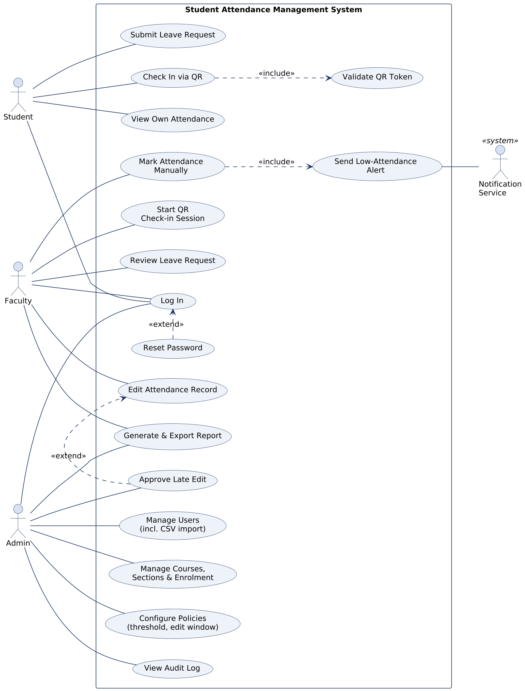
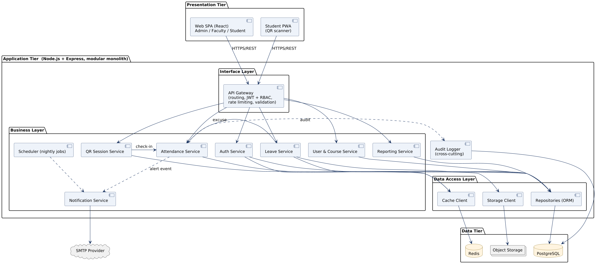
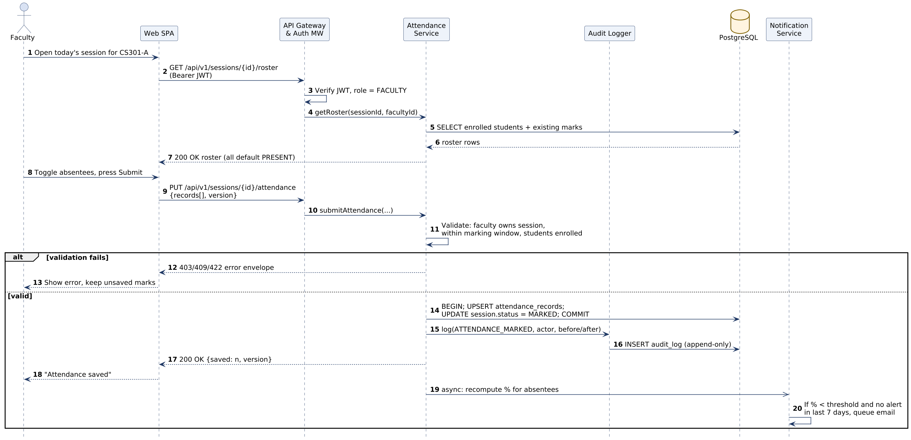
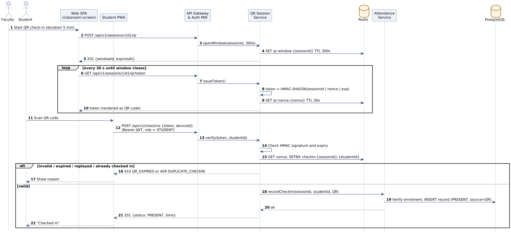
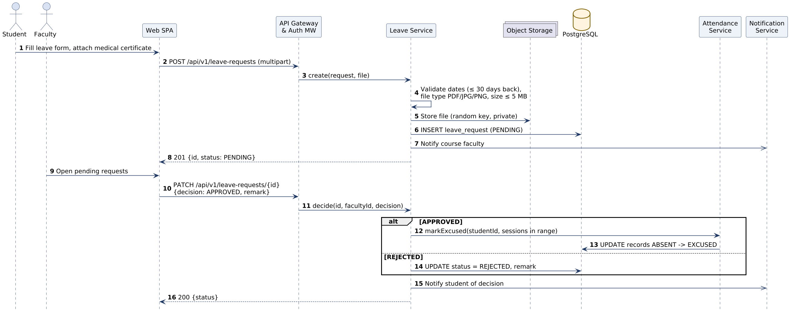

# 4 · Architecture and Design

Full specification: [SAMS Architecture Design Spec](SAMS%20Architecture%20Design%20Spec.docx). REST endpoints, request/response examples and validation rules: [API_Design.md](API_Design.md).

## Use Case Diagram (UML)

## Architectural Pattern

### Selected Pattern: Layered (N-Tier) Architecture as a Modular Monolith

SAMS uses a **three-tier client–server** architecture (presentation, application, data). Inside the application tier it follows a **strict layered pattern**:

1.  **Interface layer** routes, authentication/authorisation middleware, request validation, rate limiting. Knows HTTP; knows nothing about SQL.

2.  **Business layer** one module per domain area (Auth, User & Course, Attendance, QR Session, Leave, Reporting, Notification). Holds all rules such as edit windows, thresholds and ownership checks.

3.  **Data access layer** repositories (Prisma), cache client and storage client. The only layer that talks to PostgreSQL, Redis or object storage.

Each layer calls only the layer directly below it. Modules communicate through their public service interfaces, never through each other's tables. Background work (alerts, exports) is published as events to a job queue, which is a small **event-driven** element inside the monolith.

### Rationale and Alternatives Considered

| **Option**                   | **Pros**                                                                                          | **Cons**                                                                                         | **Decision** |
|------------------------------|---------------------------------------------------------------------------------------------------|--------------------------------------------------------------------------------------------------|--------------|
| Layered modular monolith     | Simple to build, test and deploy; one transaction boundary for marking + audit; fits a small team | Scales as one unit; needs discipline to keep module boundaries                                   | **Selected** |
| Microservices                | Independent scaling and deployment                                                                | Distributed transactions for mark + audit; much more operational work; overkill for ~5,000 users | Rejected     |
| MVC server-rendered monolith | Very simple                                                                                       | Poor mobile/PWA experience; harder to support QR scanning and a separate API                     | Rejected     |
| Serverless functions         | No server management                                                                              | Cold starts at 9 a.m. bursts; vendor lock-in; data residency harder                              | Rejected     |

The module boundaries are drawn so that a module (for example, QR Session) could be extracted into a separate service later if load required it, without changing the API contract.

## Component Diagram

### Component Descriptions

| **Component**                          | **Responsibility**                                                                  | **Provided interface**     | **Depends on**                                  |
|----------------------------------------|-------------------------------------------------------------------------------------|----------------------------|-------------------------------------------------|
| Web SPA                                | Admin, Faculty and Student user interfaces; QR display screen                       | Browser UI                 | API Gateway                                     |
| Student PWA                            | Installable student app; camera-based QR scanning                                   | Browser UI                 | API Gateway                                     |
| API Gateway & Auth Middleware          | Routing, JWT verification, RBAC, schema validation, rate limiting, error formatting | REST /api/v1/\*            | All business modules, Redis                     |
| Auth Service                           | Login, lockout, token issue/refresh/revoke, password reset                          | AuthService                | Repositories, Cache, Notification, Audit        |
| User & Course Service                  | Users, CSV import, courses, sections, enrolment, timetable → sessions, policies     | UserService, CourseService | Repositories, Audit                             |
| Attendance Service                     | Rosters, marking, corrections, percentage calculation, threshold events             | AttendanceService          | Repositories, Audit, Notification (event)       |
| QR Session Service                     | Open/close QR windows, issue and verify signed tokens, prevent replay               | QrService                  | Cache (Redis), Attendance Service               |
| Leave Service                          | Leave requests, file upload, approval, marking EXCUSED                              | LeaveService               | Repositories, Storage, Attendance, Notification |
| Reporting Service                      | Aggregated reports; CSV/PDF export as background jobs                               | ReportService              | Repositories (read replica-ready)               |
| Notification Service                   | Email and in-app notifications; alert throttling (7 days)                           | notify(event)              | Job queue, SMTP                                 |
| Scheduler                              | Nightly session generation, alert sweep, retention clean-up (NFR-09)                | Cron jobs                  | Business services                               |
| Audit Logger                           | Writes append-only audit entries for all sensitive actions                          | audit.log(entry)           | PostgreSQL (INSERT-only role)                   |
| Repositories / Cache / Storage clients | Encapsulate all data access; parameterised queries                                  | Repository interfaces      | PostgreSQL, Redis, MinIO                        |

### Deployment View

For the pilot, all containers run on one Ubuntu VM with Docker Compose: nginx (TLS termination, static SPA files, reverse proxy), api (two replicas), worker (background jobs), postgres, redis and minio. Only Nginx is exposed (ports 80→443 redirect, 443). Databases are on an internal Docker network with no published ports. Nightly pg_dump backups are encrypted and copied off-host (NFR-04).

## Sequence Diagrams

### SD-1 · Faculty marks attendance manually (FR-06, FR-11)

### SD-2 · Student checks in via QR code (FR-07, SR-05)

### SD-3 · Leave request submission and approval (FR-10)

